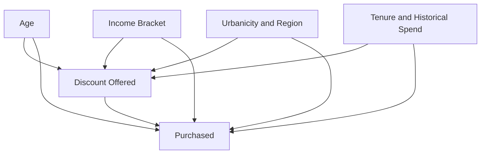

# Causal DAG — EconoCausal

## 1. Overview

EconoCausal aims to estimate the causal effect of discounts on customer purchase decisions using Double Machine Learning (DML).

A Directed Acyclic Graph (DAG) helps us understand the assumed relationships between customer characteristics, the discount offered, and the purchase outcome.

## 2. Key Variables

| Variable | Role | Description |
|---|---|---|
| `discount_offered` | Treatment (T) | Discount assigned or offered to a customer |
| `purchased` | Outcome (Y) | Indicates whether the customer made a purchase |
| `age` | Covariate (X) | Customer's age |
| `income_bracket` | Covariate (X) | Customer's income group |
| `urbanicity` | Covariate (X) | Customer's residential area type |
| `region` | Covariate (X) | Customer's geographical region |
| `tenure_months` | Covariate (X) | Duration of the customer's relationship with the business |
| `historical_spend` | Covariate (X) | Customer's spending history |

These covariates are considered potential factors that may influence discount assignment and purchasing behaviour. Their actual relationships must be checked against the dataset and its generation process.

## 3. Causal DAG

The following diagram represents the assumed causal relationships in the project.

## 4. Causal Assumptions

1. **Treatment effect:** The discount offered may affect the probability of a customer making a purchase.
2. **Customer characteristics:** Age, income, location, tenure, and historical spending may be related to purchasing behaviour.
3. **Potential confounding:** If customer characteristics influence both discount assignment and purchasing behaviour, they may create confounding. Relevant pre-treatment variables should therefore be considered when estimating the treatment effect.
4. **Pre-treatment features:** Features used as covariates should be measured before the discount is offered.
5. **Synthetic data:** The dataset is synthetic. The DAG represents assumptions for the analysis and does not establish real-world causal relationships.

## 5. Variables Excluded from the Covariates

Variables such as `revenue`, `net_profit`, and `basket_value_before_discount` should not automatically be included in the covariate set.

These variables may be affected by the treatment or purchase process. Including post-treatment variables can introduce bias into causal estimates. Their timing and meaning should be checked before deciding how to use them.

## 6. Relationship with Double Machine Learning

The DAG guides the selection of the treatment, outcome, and covariates used in the DML model.

- **T (Treatment):** `discount_offered`
- **Y (Outcome):** `purchased`
- **X (Covariates):** Selected pre-treatment customer characteristics

The DML model uses these variables to estimate the effect of changing the discount level on the purchase outcome, while adjusting for the selected covariates.

## 7. Limitations

- The DAG is based on assumptions about the synthetic dataset.
- The diagram does not prove that the assumed causal relationships are correct.
- Unobserved factors may still influence discount assignment and purchasing behaviour.
- Reliable causal interpretation depends on the validity of the assumptions and the quality of the data.

## 8. Conclusion

The causal DAG provides a conceptual foundation for EconoCausal. It helps identify the treatment, outcome, and potential confounding variables before applying Double Machine Learning to estimate discount effects.
